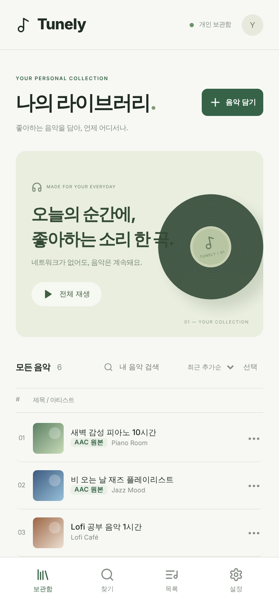
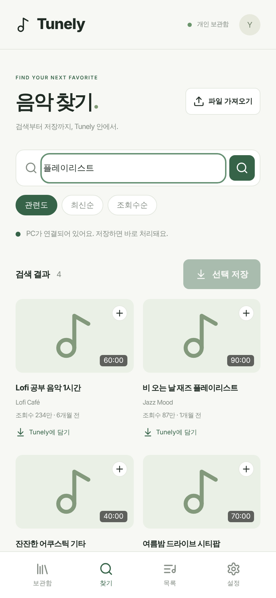
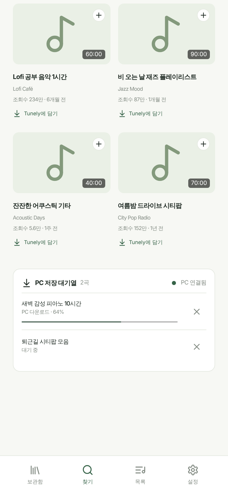
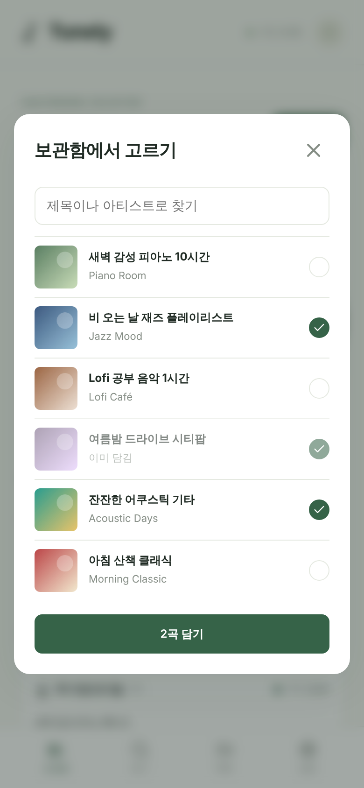

# Tunely

iPhone 홈 화면에 설치해 쓰는 개인용 음악 보관함 PWA입니다. 앱에서 YouTube를 검색해 저장을 누르면 집 Windows PC가 음원을 받아 M4A로 만들고, iPhone이 그 파일을 받아 기기 안(IndexedDB)에 보관합니다. 저장한 음악은 네트워크 없이도 재생됩니다.

<p align="center">
  
  
  
  
</p>
<p align="center"><sub>보관함 · 음악 찾기 · PC 저장 대기열 · 재생목록 곡 고르기 (예시 데이터)</sub></p>

## 주요 기능

- **검색과 저장**: YouTube 검색어나 영상 URL로 찾고, 관련도·최신순·조회수순으로 정렬합니다. 결과마다 조회수와 업로드 시점(대략)을 표시하고, 여러 곡을 골라 한 번에 저장합니다.
- **PC 처리**: 저장 요청은 대기열에 쌓이고 PC 에이전트가 순서대로 처리합니다. PC가 꺼져 있으면 기다렸다가 켜지면 처리합니다.
- **AAC 우선**: YouTube의 AAC 음원(itag 140)이 있으면 재인코딩 없이 그대로 담아 몇 초 안에 끝나고, 보관함에 `AAC 원본` 배지가 붙습니다. 없으면 Opus 등을 AAC로 변환합니다.
- **긴 음원**: 10시간짜리 플레이리스트처럼 큰 파일은 40MB 조각으로 나눠 보내고, iPhone이 조각별로 저장했다가 재생할 때 합칩니다.
- **오프라인 재생**: 셔플, 한 곡/전체 반복, 0.5–2배속, 잠금 화면 제어(Media Session)를 지원하고, 다시 열면 재생 위치와 대기열을 복원합니다.
- **재생목록**: 보관함에 저장된 곡 중에서 골라 담고, 순서를 바꿉니다.
- **서버에 남기지 않음**: iPhone이 받는 즉시 서버의 음원 파일과 작업 기록을 지웁니다. 받지 않은 요청은 3일 뒤 정리합니다.

## 구조

```
iPhone PWA ──검색──▶ Vercel API (FastAPI + yt-dlp 검색)
     │ 저장 요청
     ▼
Vercel API ──▶ Supabase DB (jobs 대기열)
                    ▲  작업 가져가기 · 진행률 보고 (AGENT_TOKEN)
Windows PC 에이전트 ─┤  yt-dlp 다운로드 → FFmpeg M4A → 썸네일 jpg
                    └▶ Supabase Storage (40MB 조각, 서명 URL로 직접 업로드)
PWA ◀── 서명 URL로 조각 수신 → IndexedDB 저장 → 서버 파일·기록 삭제
```

Vercel에서 YouTube 다운로드를 시도하면 봇으로 판단되어 차단되기 때문에, 다운로드와 변환은 집 PC에서 합니다. Vercel은 검색, 로그인, 중계만 맡습니다.

| 구성 | 위치 | 역할 |
|---|---|---|
| PWA | `app/` (Next.js 정적 내보내기) | 검색·저장 요청, 수신, 보관함, 재생 |
| API | `api/index.py` (Vercel Python Function) | 로그인, 검색, 대기열, 에이전트 엔드포인트, 정리 Cron |
| 검색 워커 | `backend/worker.py` | yt-dlp 검색을 별도 프로세스로 실행 |
| PC 에이전트 | `agent/` | 대기열 처리, 다운로드·변환·업로드, 터미널 진행률 |
| 대기열·임시 파일 | Supabase | `jobs`·`agents` 테이블, `claim_job()` 함수, 비공개 `transfers` 버킷 |

작업 상태는 `queued → processing → ready → (수신 후 삭제)`이며, 실패하면 `failed`가 되고 앱에서 재시도할 수 있습니다. 처리 중 15분 넘게 소식이 없는 작업은 자동으로 `queued`로 돌아갑니다.

## iPhone에서 사용하기

1. iPhone Safari에서 배포 주소(`https://tunely-play.vercel.app`)를 엽니다.
2. 공유 → **홈 화면에 추가**로 설치하고, 앱 전용 비밀번호로 로그인합니다. 로그인은 30일 동안 유지되며 자동 연장되지 않습니다.
3. ‘찾기’에서 곡을 고르고 **Tunely에 담기**를 누릅니다.
4. PC가 처리를 마치면, 앱이 열려 있는 동안 자동으로 받아 보관함에 넣습니다. iOS PWA는 백그라운드에서 받을 수 없으므로, 앱을 열어야 수신이 시작됩니다.

새 버전은 앱을 완전히 닫았다가 다시 열 때 적용됩니다.

## Windows PC 에이전트 설정

1. Python 3.12와 Deno를 설치합니다. yt-dlp는 YouTube 처리에 Deno를 씁니다.
   ```bash
   winget install Python.Python.3.12
   ```
   ```bash
   winget install DenoLand.Deno
   ```
2. 한글·공백이 없는 경로에 저장소를 받습니다. 예: `D:\tunely`
   ```bash
   git clone https://github.com/yjkim-94/tunely.git
   ```
3. `agent\.env.example`을 `agent\.env`로 복사하고 값을 채웁니다. `AGENT_TOKEN`은 Vercel 환경변수와 같은 값이며, 비밀번호처럼 다룹니다.
   ```
   TUNELY_URL=https://tunely-play.vercel.app
   AGENT_TOKEN=...
   ```
4. `agent\run-agent.bat`을 실행합니다. 첫 실행에 `.venv`를 만들고 `agent\requirements.txt`를 설치하며, 실행할 때마다 yt-dlp를 최신으로 올립니다. FFmpeg는 `imageio-ffmpeg`로 함께 설치됩니다.

창이 떠 있는 동안 대기열을 처리하고, 터미널에 단계별 진행률을 한 줄로 갱신합니다.

```
[15:43:27] 처리 시작: ...
  다운로드 [##########----------]  50%  8.0/15.9 MB · 2.0 MB/s
  M4A 정리 [####################] 100%  2초
  업로드   [####################] 100%  조각 1/1 · 전체 8.8 MB
[15:43:35]   완료 · 8.8 MB · 1개 조각 업로드
```

**로그인할 때 자동 실행**: `Win + R` → `shell:startup`으로 연 폴더에 `run-agent.bat` 바로가기를 넣습니다. 바로가기 속성의 ‘실행’을 ‘최소화’로 바꾸면 작업 표시줄에만 떠 있습니다.

**업데이트**: 에이전트 창을 닫고 `D:\tunely`에서 `git pull` 후 다시 실행합니다.

| 증상 | 조치 |
|---|---|
| `Deno 없음` | 설치 후 PowerShell을 다시 열거나 재부팅 |
| `서버 연결 실패` 반복 | `agent\.env`의 `TUNELY_URL`과 인터넷 연결 확인 |
| HTTP 401 | `AGENT_TOKEN` 값이나 앞뒤 공백 확인 |
| `업로드 실패 (HTTP 413)` | 구버전 에이전트입니다. `git pull` 후 재실행 |
| `Sign in to confirm you're not a bot` | 집 IP도 YouTube가 제한한 경우로, 쿠키 사용 기능 추가가 필요합니다 |

## 배포 (Vercel + Supabase)

이 프로젝트는 **Next.js 정적 내보내기 + Python Function 하나**입니다. `vercel.json`에 빌드 명령(`npm run build`), 출력 폴더(`out`), 함수 설정, 매일 도는 정리 Cron(`/api/cron/cleanup`)이 들어 있습니다. main 브랜치에 병합하면 Production에 배포됩니다.

**Supabase**: 프로젝트를 만들고 `jobs`·`agents` 테이블, `claim_job()` 함수, 비공개 `transfers` 버킷을 둡니다. 모든 테이블에 RLS를 켜고, 서버 키로만 접근합니다. 무료 플랜은 파일당 50MB, Storage 전체 1GB 제한이 있어 조각 크기를 40MB로 정했습니다.

**Vercel 환경변수**

| 이름 | 내용 |
|---|---|
| `APP_PASSWORD_HASH` | 앱 비밀번호의 Argon2 해시 (`scripts/configure.py`로 생성, `$` 포함 그대로) |
| `SESSION_SECRET` | 세션 서명 키 (32자 이상) |
| `APP_ORIGIN` | 서비스 주소, 예: `https://tunely-play.vercel.app` |
| `COOKIE_SECURE` | `true` |
| `SUPABASE_URL` | Supabase 프로젝트 URL |
| `SUPABASE_SECRET_KEY` | Supabase 대시보드 → Project Settings → API Keys의 secret key |
| `AGENT_TOKEN` | PC 에이전트 인증 토큰 (PC의 `agent\.env`와 같은 값) |
| `CRON_SECRET` | 정리 Cron 인증 값 |

Preview 배포는 Vercel 로그인 보호와 Production 전용 환경변수 때문에 에이전트·로그인 확인용으로 쓸 수 없습니다.

## 개발

Node.js 20.9 이상과 Python 3.12 이상이 필요합니다.

```bash
npm ci
python3 -m venv .venv
.venv/bin/python -m pip install -r requirements.txt
.venv/bin/python scripts/configure.py
npm run dev
```

`http://localhost:3000`에서 설정한 비밀번호로 로그인합니다. `npm run dev`가 Next.js와 Python API(8000번 포트)를 함께 실행합니다. Windows에서는 `.venv\Scripts\python.exe`를 씁니다.

루트 `requirements.txt`는 Vercel 함수용(검색만)이고, PC 에이전트는 FFmpeg 등을 포함한 `agent/requirements.txt`를 씁니다.

**검사**

```bash
npm run typecheck
```
```bash
npm run build
```
```bash
.venv/bin/python -m unittest discover -s tests -v
```

백엔드 테스트는 로그인·세션 만료·출처 검사·URL 검증·호출 제한, 대기열 등록·중복 방지·수신 후 삭제, 에이전트 인증·조각 업로드 URL·취소 충돌, 검색 정렬 전달, 오류 문구의 서명 URL 제거, 정리 Cron 인증을 확인합니다. Supabase와 YouTube 통신은 테스트에서 대체하므로 실제 다운로드 성공을 보장하지 않습니다.

## 제약과 주의사항

- iOS PWA는 백그라운드 다운로드가 불가능해, 앱이 열려 있을 때만 PC에서 처리된 곡을 받습니다.
- 음악은 iPhone의 웹 저장소에만 있습니다. iOS 저장 공간 정리나 앱·웹사이트 데이터 삭제 시 사라질 수 있고, 백업·기기 간 동기화는 없습니다.
- 업로드 시점은 YouTube의 “1년 전” 같은 문구를 환산한 대략적인 값입니다.
- 로그인 호출 제한은 함수 인스턴스별입니다. 외부에 공개한다면 Vercel Firewall에서 별도 제한을 두세요.
- 개인용 앱입니다. 저장할 권리가 있는 콘텐츠만 이용하세요.

참고: [yt-dlp](https://github.com/yt-dlp/yt-dlp), [Vercel Python 런타임](https://vercel.com/docs/functions/runtimes/python), [Supabase Storage](https://supabase.com/docs/guides/storage).
